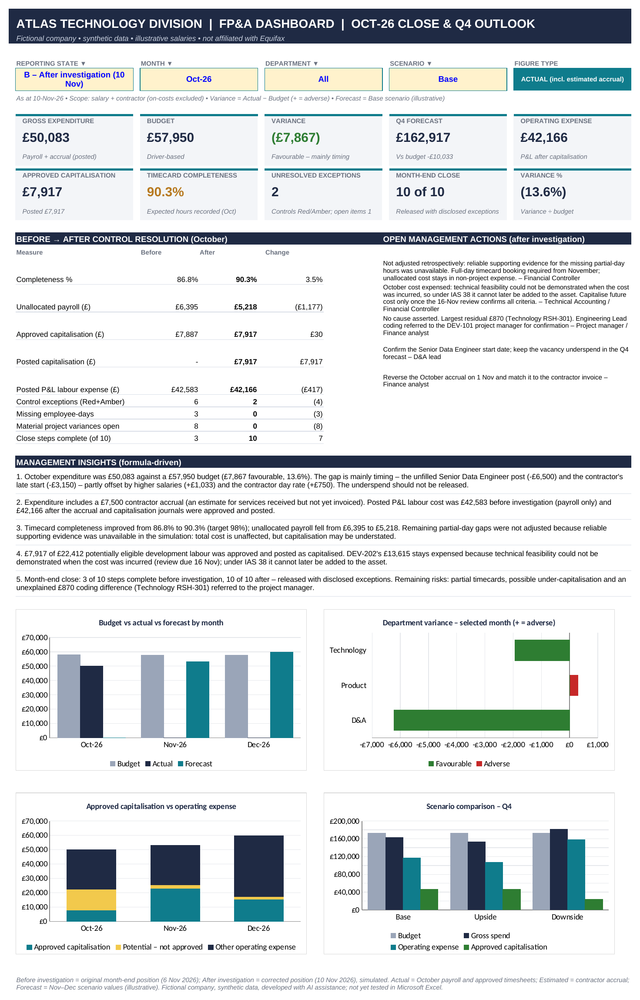

# Atlas Technology Division | FP&A Portfolio

Independent Excel FP&A portfolio demonstrating technology labour cost analysis, budgeting, forecasting, capitalised labour accounting, financial controls and month-end reporting using synthetic data.

> **Disclosure:** This is an independent portfolio project. Atlas Technology Division is a fictional company, and every figure is synthetic. The project is not affiliated with Equifax or any employer, and it is not paid or client work. It was developed with AI assistance.

## Project overview

A Finance Business Partner supports three technology departments: Data & Analytics, Product and Technology. Each month they need to:

- explain labour and contractor spend against budget;
- decide which development labour can be capitalised;
- forecast the quarter;
- close the month on reliable timecard data.

The project models October 2026 for this fictional division and produces a one-page executive dashboard and a management case study.

## Financial reporting problem identified

The first version of the model calculated actual cost as recorded timecard hours × hourly rate, and it reported a 45% underspend.

That was wrong. Salaried staff are paid in full whether or not they submit timecards, so missing timecards were being reported as savings.

**The correction:**

- Actual expenditure is now taken from payroll (annual salary ÷ 12).
- Timecards are used only to allocate that payroll to projects.
- Any payroll not covered by timecards is shown separately as unallocated cost, not as a saving.
- Unrealistic hourly rates were replaced with illustrative salaries of £42k–£90k.
- The budget was rebuilt from headcount, salary, leave and contractor drivers.

## Key financial findings (October 2026, synthetic)

| Measure | Result |
|---|---|
| Expenditure | **£50,083** |
| Budget | **£57,950** |
| Variance | **£7,867 (13.6%) favourable** |
| Approved capitalised labour | **£7,917** |
| Timecard completeness | **86.8% → 90.3%** after investigation |

The variance is fully explained by four drivers:

| Driver | Effect |
|---|---|
| Unfilled Senior Data Engineer post | −£6,500 |
| Contractor started 11 days late | −£3,150 |
| Contractor day rate above budget | +£750 |
| Salaries above the budget rate card | +£1,033 |

The two main drivers, the vacancy and the late contractor start, are timing effects rather than savings. The underspend should therefore not be released.

Of £22,412 potentially eligible development labour, £7,917 met the IAS 38 evidence and approval rules and was capitalised. One project, DEV-202, has £13,615 of October cost that remains expensed because technical feasibility could not be demonstrated when the cost was incurred. Under IAS 38, cost expensed before the recognition criteria are met cannot later be added to the asset.

## Skills demonstrated

- **Budget versus actual analysis:** a driver-based variance bridge with a materiality threshold.
- **Forecasting and scenario modelling:** a Q4 forecast with base, upside and downside scenarios.
- **Capitalised labour accounting:** IAS 38 recognition criteria, evidence and approval tiers, and a comparison with US GAAP (ASC 350-40).
- **Timecard reconciliation:** completeness measured against payroll, with unallocated cost tracked.
- **Month-end accounting:** a contractor accrual of £7,500, its November reversal and invoice matching, and a 10-step close checklist.
- **Financial controls:** exception checks, a resolution log and close sign-off.
- **Variance investigation:** project variances split into genuine cost, re-plan reclassification, timecard completeness and coding differences.
- **Excel financial modelling:** formula-driven reporting with dropdown selectors.

## Key business recommendations

1. Require full-day timecard booking, so that payroll is fully allocated.
2. Treat the vacancy underspend as timing and do not release it.
3. Capitalise DEV-202 cost only once all IAS 38 criteria are demonstrated (review due 16 November).
4. Align budget allocations with the current project resource plan.
5. Reconcile the October contractor accrual to the November invoice.

## Tools and methodology

- **Excel:** SUMIFS, COUNTIFS, SUMPRODUCT, INDEX/MATCH, named ranges, data validation dropdowns, Excel Tables, conditional formatting and charts. The model contains no macros.
- **Reporting logic:**
  - Payroll is the source of actual cost.
  - Timecards allocate payroll to projects.
  - Capitalisation applies only to approved, evidenced development time.
  - The dashboard can show the month before and after the investigation.
- **AI-assisted development:** The workbook, tests and reports were generated with AI assistance (Python) and recalculated in LibreOffice. Testing included four negative test cases and a dataset seeded with 15 deliberate errors. These tests were produced by the same AI-assisted process as the model, so they are not independent verification.

## Limitations

- All data is synthetic, and the company is fictional.
- The project is not affiliated with Equifax.
- The model was developed with AI assistance.
- The project resource plan is illustrative and was constructed for the simulation.
- Employer on-costs (National Insurance and pension) are excluded from the primary cost model, so capitalised amounts are conservative.
- **The workbook has not yet been tested in Microsoft Excel**, and the key figures have not yet been checked by hand. For that reason the workbook is not yet included in this repository. It will be added once both checks are complete.

## How to explore the project

1. **Start with the dashboard image above**, or open [`Executive_Dashboard.pdf`](Executive_Dashboard.pdf). Page 1 shows the month after the investigation; page 2 shows it before.
2. **Read [`Atlas_FPA_Case_Study.pdf`](Atlas_FPA_Case_Study.pdf)**, a one-page summary of the problem, the correction, the findings and the recommendations.
3. **Explore the workbook (once published).** The four most relevant worksheets are:
   - **Dashboard:** KPIs, the before/after comparison, open actions and insights.
   - **Variance Investigation:** the variance drivers and the project-level analysis.
   - **Capitalisation:** the IAS 38 register, the evidence tiers and the intangible asset schedule.
   - **Close:** the 10-step month-end checklist and its sign-off.
